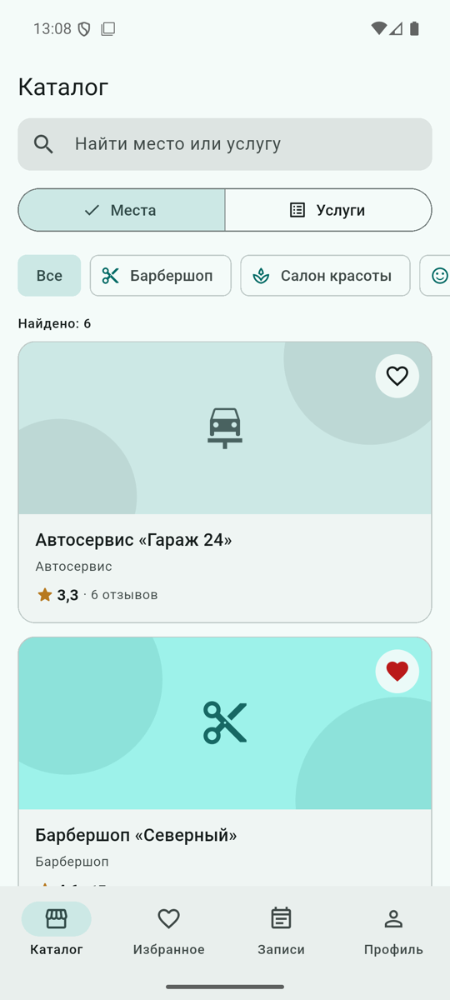
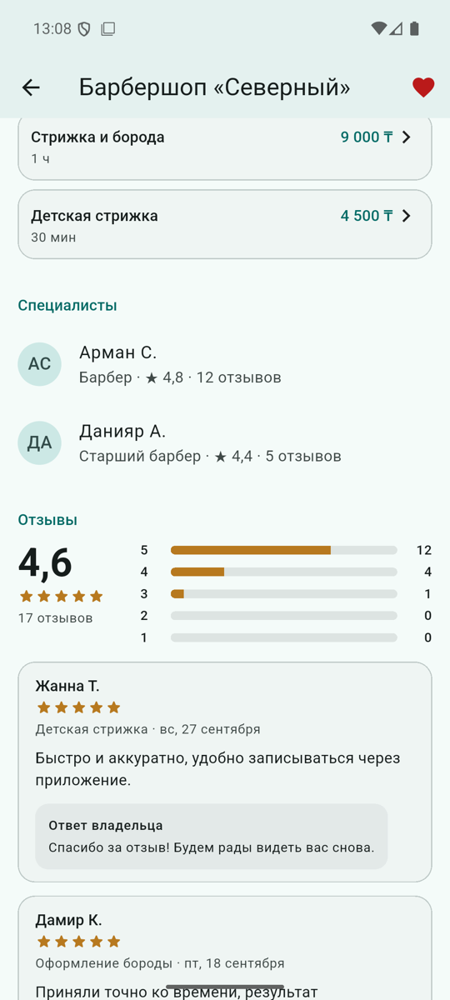
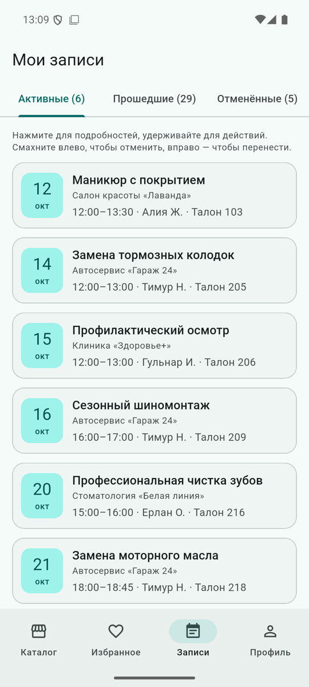
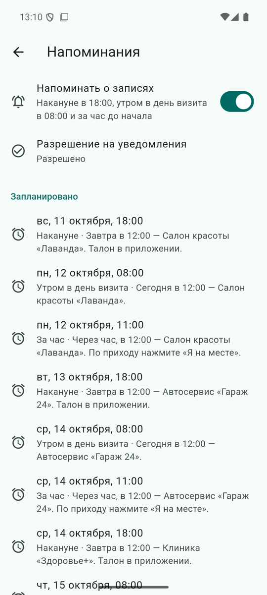
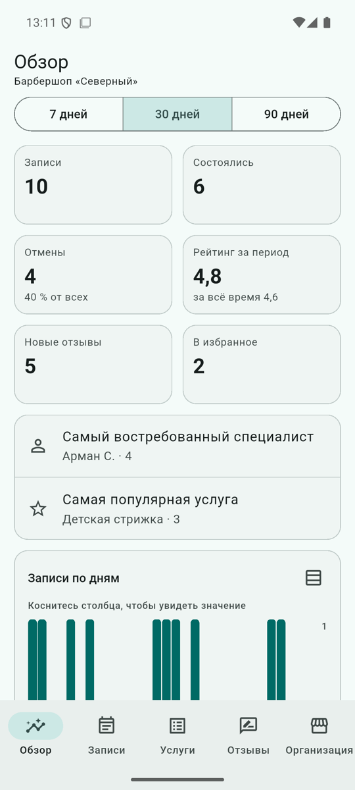
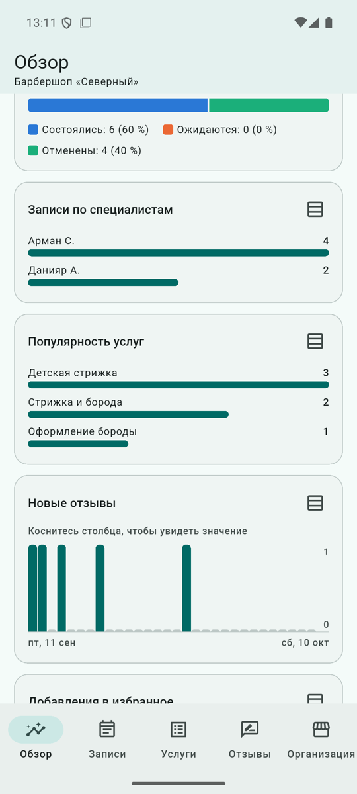
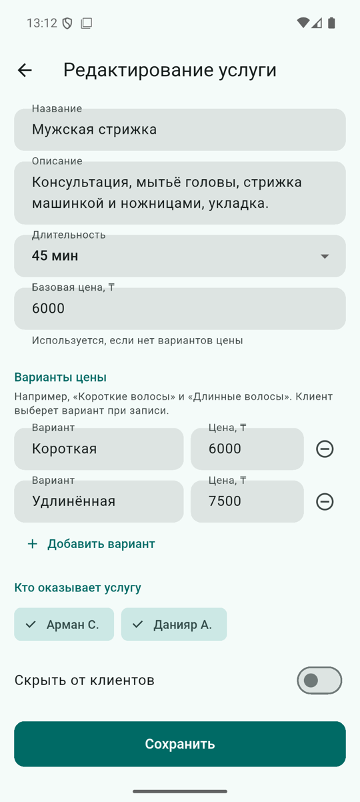
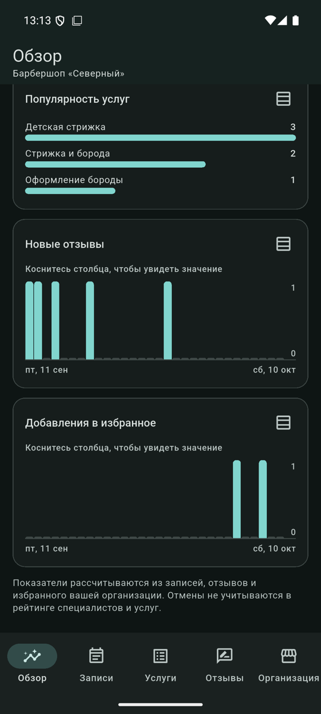

# Slotly

Учебный MVP мобильного сервиса онлайн-записи для локального бизнеса с двумя ролями: клиент ищет место, записывается, оставляет отзывы и получает напоминания; владелец управляет организацией и видит аналитику своей организации.

Flutter 3.47 · Dart 3.13 · Material 3 · Android 7.0+ · версия 0.2.0

<p>
  
  
  
  
</p>
<p>
  
  
  
  
</p>

Скриншоты сняты с реального приложения на эмуляторе Android 16. Все организации, люди, адреса и записи вымышлены.

> **Граница версии.** Всё работает на устройстве: демо-вход, проверка прав, хранение, аналитика и напоминания. Это прототип серверной системы, а не production-backend и не система безопасности.

## Демо-аккаунты

Публичные тестовые данные — специально опубликованы и ничего не защищают.

| Роль | Организация | Логин | Пароль | Что проверять |
|---|---|---|---|---|
| Клиент | — | `aliya` | `aliya-demo` | История визитов, отзывы, избранное, перенос |
| Клиент | — | `damir` | `damir-demo` | Будущие записи, напоминания, «Я на месте» |
| Владелец | Барбершоп «Северный» | `north` | `north-demo` | Аналитика, услуги и цены, фото, ответы на отзывы |
| Владелец | Стоматология «Белая линия» | `whiteline` | `whiteline-demo` | Изоляция данных организаций |
| Клиент | — | `zhanna` | `zhanna-demo` | Дополнительная история |
| Клиент | — | `ilya` | `ilya-demo` | Дополнительная история |

## Возможности

| Роль | Что умеет |
|---|---|
| Клиент | Каталог мест и услуг с поиском и фильтром, рейтинг, страница организации с галереей до 5 фото (pinch, свайп вниз), прайс с вариантами цены, специалисты с рейтингом; запись, перенос, отмена, «Я на месте»; отзыв после визита; избранное (двойное касание или сердце); локальные напоминания |
| Владелец | Обзор с KPI и графиками за 7/30/90 дней и табличным видом; записи организации, «Визит состоялся», отметка прихода по рукописному номеру талона; услуги, варианты цены, скрытие; ответы на отзывы; профиль организации и фото |
| Оба | Welcome, вход, тёмная тема (сохраняется), «Для разработчиков»: диагностика жизненного цикла и Gesture Lab |

## Технологии

| Область | Решение |
|---|---|
| UI | Flutter, Material 3, токены темы и `SlotlyColors` |
| Состояние | `ChangeNotifier`, `LiveQuery`, `setState` |
| Навигация | `Navigator`, корень по роли, `NavigationBar` + `IndexedStack` |
| Данные | `AppDatabase` — версионируемый JSON-документ за контрактами репозиториев |
| Права | `AccessPolicy` в каждом репозитории |
| Зависимости | `crypto`, `path_provider`, `image_picker`, `flutter_local_notifications`, `timezone`, `flutter_timezone` |
| Тесты | unit, widget, golden, 8 интеграционных сценариев, замер кадров |

## Архитектура

Feature-first: `domain` (модели и правила на Dart), `data` (репозитории с проверкой прав), `presentation` (экраны и контроллеры); общий слой данных — `lib/data/`, сборка — `lib/app/`. Подробно: [архитектура](docs/architecture.html), [ADR](docs/architecture-decisions.html), [план эволюции](docs/product-evolution-plan.html).

```
lib/
  main.dart
  app/        корень по роли, оболочки клиента и владельца, маршруты, тема
  core/       access/ (права), state/ (LiveQuery), lifecycle/, utils/, widgets/, app_strings.dart
  data/       local/ (база, миграции), seed/ (демо-данные)
  features/   auth  catalog  booking  reviews  favorites  business  analytics  reminders
              gesture_checkin  welcome  profile  diagnostics  gesture_lab
test/  integration_test/  test_driver/  design/  docs/  tool/
```

## Быстрый старт

Требования: Flutter 3.47 (stable), JDK 17, Android SDK (platform 36), эмулятор или телефон с Android 7.0+. Установка на macOS — [docs/environment.html](docs/environment.html).

```bash
flutter pub get
./tool/start_emulator.sh                 # поднять эмулятор (в VS Code F5 делает это сам)
flutter run -d emulator-5554
```

### Команды

```bash
dart format --output=none --set-exit-if-changed .
flutter analyze
flutter test --coverage && dart run tool/coverage_summary.dart
flutter test integration_test/app_test.dart -d emulator-5554
flutter drive --profile -d emulator-5554 --driver=test_driver/perf_driver.dart \
  --target=integration_test/perf_test.dart
flutter build apk --release              # подпись debug-ключом, не для публикации
adb shell pm clear kz.slotly.mobile      # сбросить демо-данные на устройстве
open docs/index.html
open design/prototype/index.html
```

Финальная проверка 10 октября 2026: формат и анализ без замечаний, 344 прогонов `flutter test`, покрытие domain + data — 94,9 %, всего `lib/` — 93,4 %; 8 интеграционных сценариев на эмуляторе API 36; debug и release APK. Подробно — [docs/testing.html](docs/testing.html).

## Команда

| Участник | Зона версии 0.2.0 | Отчёт |
|---|---|---|
| Кирилл Першин | интеграция архитектуры, вход и сессия, навигация по ролям, права, напоминания, CI, сборка | [docs/team/kirill.html](docs/team/kirill.html) |
| Влад Задорожный | хранилище, репозитории, seed, отзывы и рейтинг, аналитика, тесты прав | [docs/team/vlad.html](docs/team/vlad.html) |
| Ян Тонков | дизайн-система, экраны клиента и владельца, галерея, графики, жесты, widget- и golden-тесты | [docs/team/yan.html](docs/team/yan.html) |

Зоны описывают ответственность за изучение, сопровождение и защиту; фактическое авторство видно в истории Git. Задачи — [PROJECT_TASKS.md](PROJECT_TASKS.md), изменения — [CHANGELOG.md](CHANGELOG.md), процесс — [CONTRIBUTING.md](CONTRIBUTING.md).

## Известные ограничения

- Вход, права, данные и аналитика — на устройстве; пароли демо-аккаунтов публичны.
- Напоминания локальные и неточные по времени (окно Android до часа), не push.
- Изменения владельца не доходят до клиента на другом устройстве: сервера нет.
- Плавность измерена только на эмуляторе с программной отрисовкой; на реальном телефоне — не измерялась.
- Release APK подписан debug-ключом; iOS не настроен; Figma-проект не создан (есть 11 SVG и инструкция).
- CI на GitHub ещё не запускался: репозиторий не опубликован.

## План развития

Django/DRF и PostgreSQL, серверная авторизация с access/refresh token, серверная проверка прав и мультитенантность, объектное хранилище фото, FCM и серверный планировщик, агрегаты аналитики, аудит, резервное копирование и мониторинг — [docs/future-roadmap.html](docs/future-roadmap.html).
