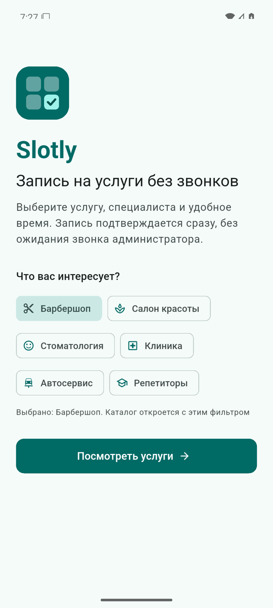
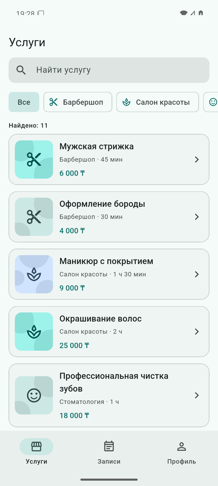
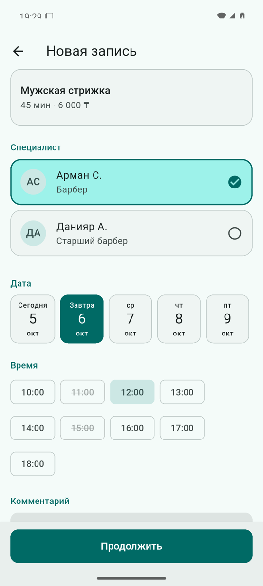
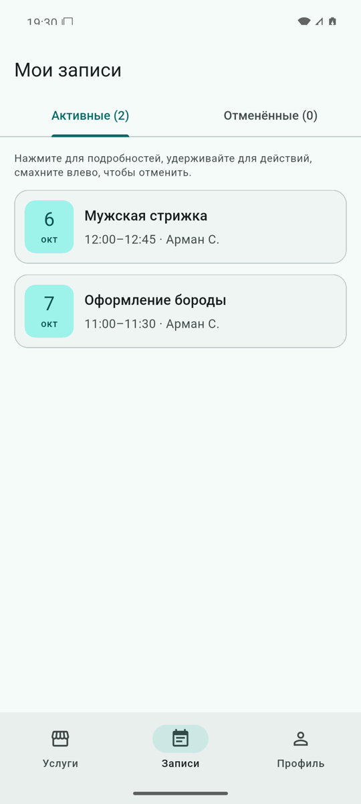
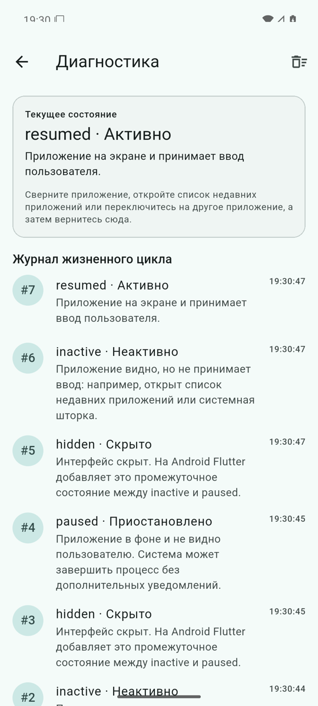
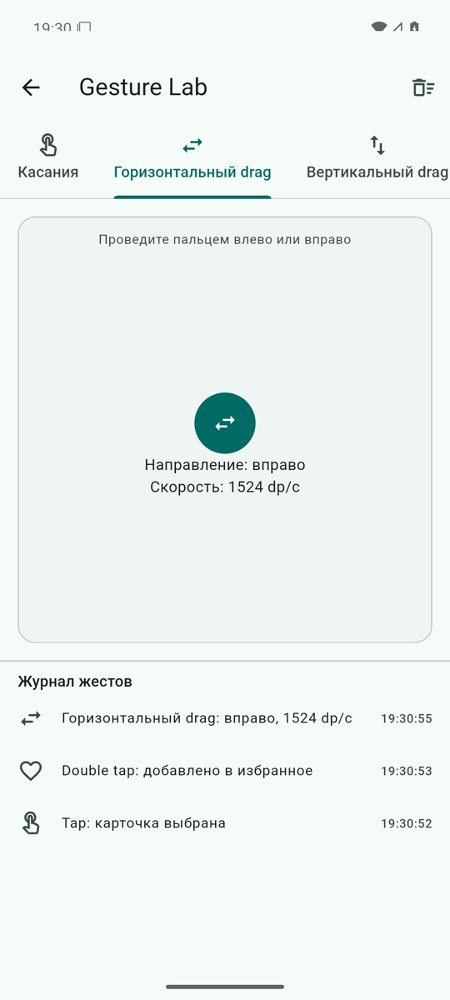
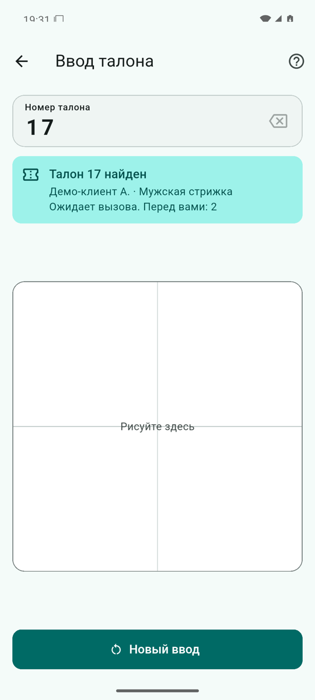
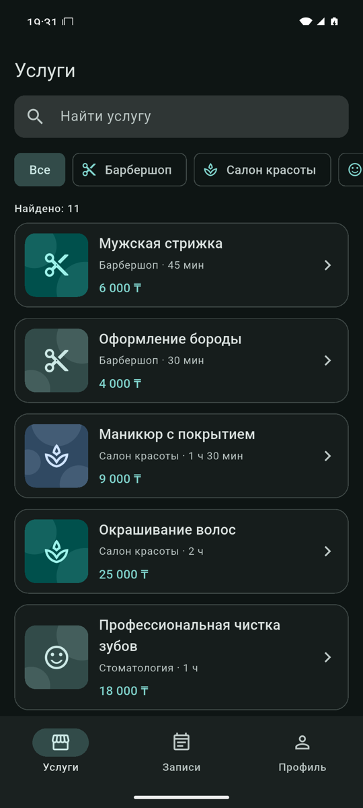

# Slotly

Учебный MVP мобильного сервиса онлайн-записи и электронной очереди для локального бизнеса: барбершопов, салонов красоты, стоматологий, клиник, автосервисов и репетиторов.

Flutter 3.47 · Dart 3.13 · Material 3 · Android 7.0+ · версия 0.1.0

<p>
  
  
  
  
</p>
<p>
  
  
  
  
</p>

Скриншоты сняты с реального приложения на эмуляторе Android 16. Все услуги, специалисты, клиенты и записи — вымышленные демонстрационные данные.

## Цели

- Закрыть требования лабораторных работ №1–3 и самостоятельной работы.
- Получить реально запускающееся и проверенное Android-приложение.
- Сделать код понятным для разработчиков без глубокого опыта во Flutter.
- Равномерно распределить зоны ответственности между тремя участниками.
- Заложить расширяемую, но не переусложнённую основу для коммерческой версии.

## Возможности

| Раздел | Что умеет |
|---|---|
| Welcome | Логотип, слоган, выбор категории (`StatefulWidget` + `setState`), переход в каталог |
| Каталог | Поиск без учёта регистра, фильтр категорий, карточки, empty state |
| Детали услуги | Иллюстрация, цена, длительность, описание, специалисты |
| Запись | Специалист, дата, свободное время, комментарий, валидация, `AlertDialog`, `SnackBar` |
| Мои записи | Активные и отменённые, сортировка, tap — детали, long press — меню, свайп — отмена с подтверждением |
| Профиль | Демо-пользователь, светлая/тёмная тема, демо-уведомления, учебные инструменты, версия |
| Диагностика | Текущее состояние `AppLifecycleState`, нумерованный журнал с временем и описанием |
| Gesture Lab | Tap, double tap, long press, горизонтальный и вертикальный drag, pinch — в отдельных зонах с журналом |
| Ввод талона | `GesturePad` (`CustomPaint` + pan-жесты), распознавание 0–9 и S по шаблонам, проверка талона |

## Технологии

| Область | Решение |
|---|---|
| UI | Flutter, Material 3, тема из одного seed-цвета |
| Состояние | `ChangeNotifier`, `setState` |
| Навигация | `Navigator`, `NavigationBar`, `IndexedStack` |
| Данные | Контракты `BookingRepository`, `TicketRepository`; реализации в памяти с демо-данными |
| Локализация | Русский, тексты в `lib/core/app_strings.dart`, `flutter_localizations` |
| Тесты | `flutter_test` (unit, widget, golden), `integration_test` |
| CI | GitHub Actions |
| Зависимости | Только Flutter SDK и `flutter_lints` |

## Архитектура

Feature-first: каждая функция в своей папке, внутри — `domain` (модели и правила на чистом Dart), `data` (реализации и демо-данные), `presentation` (экраны и контроллеры). Все зависимости создаются в одном месте — `AppDependencies` — и передаются экранам через конструкторы. Подробно: [docs/architecture.html](docs/architecture.html) и [docs/architecture-decisions.html](docs/architecture-decisions.html).

```
lib/
  main.dart
  app/            app.dart, app_scope.dart, app_controller.dart, home_shell.dart, routes.dart, theme.dart
  core/           app_strings.dart, lifecycle/, utils/, widgets/
  features/
    welcome/  catalog/  booking/  profile/  diagnostics/  gesture_lab/  gesture_checkin/
test/             unit, widget и golden-тесты (+ helpers)
integration_test/ сценарий записи на устройстве
design/           прототип, UI kit, SVG для Figma
docs/             HTML-документация
tool/             сводка покрытия
```

## Быстрый старт

Требования: Flutter 3.47 (stable), JDK 17, Android SDK (platform 36, build-tools), эмулятор или телефон с Android 7.0+. Пошаговая установка на macOS — [docs/environment.html](docs/environment.html).

```bash
git clone <URL репозитория> slotly-mobile
cd slotly-mobile
flutter pub get
flutter doctor -v
```

### Запуск на эмуляторе

```bash
# создать AVD один раз
avdmanager create avd -n slotly_api36 \
  -k "system-images;android-36;google_apis;arm64-v8a" -d pixel_7
# запустить эмулятор
"$ANDROID_HOME/emulator/emulator" -avd slotly_api36
# запустить приложение
flutter devices
flutter run -d emulator-5554
```

### Команды

```bash
dart format --output=none --set-exit-if-changed .   # проверка форматирования
flutter analyze                                       # статический анализ
flutter test                                          # unit, widget, golden (105 тестов)
flutter test --coverage && dart run tool/coverage_summary.dart
flutter test integration_test -d emulator-5554        # интеграционный тест
flutter build apk --debug                             # build/app/outputs/flutter-apk/app-debug.apk
flutter build apk --release                           # подпись debug-ключом, не для публикации
open docs/index.html                                  # документация
open design/prototype/index.html                      # интерактивный прототип
```

Результаты финальной проверки: формат и анализ без замечаний, 105 тестов проходят, покрытие domain + data — 92,8 %, всего `lib/` — 95,6 %, интеграционный тест пройден на эмуляторе API 36. Подробно — [docs/testing.html](docs/testing.html).

## Жесты

| Где | Жест | Действие |
|---|---|---|
| Мои записи | tap | детали записи |
| Мои записи | long press | меню действий |
| Мои записи | свайп влево | запрос отмены с подтверждением |
| Gesture Lab | tap / double tap / long press | выбор / избранное / меню |
| Gesture Lab | horizontal drag | направление и скорость |
| Gesture Lab | vertical drag | смещение |
| Gesture Lab | pinch | масштаб 0,5–3× (на эмуляторе: Cmd/Ctrl + мышь) |
| Ввод талона | рисование (pan) | цифры 0–9 добавляются к номеру, `S` завершает ввод |

Распознавание — объяснимый template matching без ML: нормализация, 48 точек, сравнение облаков точек с шаблонами, отказ при уверенности ниже 55 %. Работает на подготовленных шаблонах и близких к ним рисунках; это не универсальный распознаватель почерка. Подробно — [docs/lab-3.html](docs/lab-3.html).

## Команда и зоны ответственности

| Участник | Зона | Страница |
|---|---|---|
| Кирилл | каркас, навигация, тема, lifecycle и диагностика, «Мои записи», CI, сборка, архитектурная документация | [docs/team/kirill.html](docs/team/kirill.html) |
| Влад | модели, репозиторий, демо-данные, поиск, форма записи, распознавание жестов, ввод талона | [docs/team/vlad.html](docs/team/vlad.html) |
| Ян | UI kit, прототип, welcome, каталог, детали, профиль, Gesture Lab, адаптивность, widget- и golden-тесты | [docs/team/yan.html](docs/team/yan.html) |

Трудоёмкость каждой зоны оценена в условные 16 баллов — это внутренняя оценка баланса, а не прогноз оценки. Распределение описывает зоны ответственности и сопровождения; первичная реализация закоммичена владельцем репозитория, фактическое авторство видно в истории Git. Задачи и статус — [PROJECT_TASKS.md](PROJECT_TASKS.md).

## Git-процесс

- Основная ветка — `main`, изменения через ветки `feature/…`, `fix/…`, `docs/…` и pull request.
- Сообщения коммитов — [Conventional Commits](https://www.conventionalcommits.org/ru/v1.0.0/).
- Перед коммитом: формат, `flutter analyze`, тесты изменённого модуля.
- Теги: `lab-1`, `lab-2`, `lab-3` — состояние на момент сдачи каждой лабораторной, `v0.1.0` — финальный MVP.

Подробно — [CONTRIBUTING.md](CONTRIBUTING.md), история изменений — [CHANGELOG.md](CHANGELOG.md).

## Известные ограничения

- Данные хранятся в памяти и пропадают при закрытии приложения; настройки темы не сохраняются.
- Нет авторизации, backend, уведомлений и платежей — это вне границ MVP.
- Распознавание рукописного ввода рассчитано на шаблоны; например, «Z» может распознаться как «2».
- Pinch на эмуляторе выполняется мышью с Cmd/Ctrl; `adb shell input` мультитач не поддерживает.
- Release APK подписан debug-ключом из шаблона Flutter и не предназначен для публикации.
- Figma-файл не создавался (не было доступа); для импорта подготовлены SVG и инструкция.
- iOS не настраивался: платформа MVP — Android.

## План развития

Django/DRF API и PostgreSQL, роли клиента, сотрудника и владельца, мультитенантность, расписания сотрудников, напоминания и push, офлайн-синхронизация, iOS, публикация через CI/CD. Текущие контракты репозиториев позволяют подключить сервер без переписывания экранов. Подробно — [docs/future-roadmap.html](docs/future-roadmap.html).
